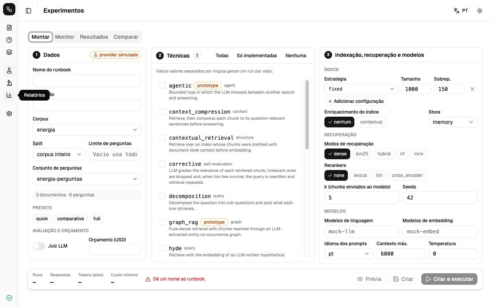
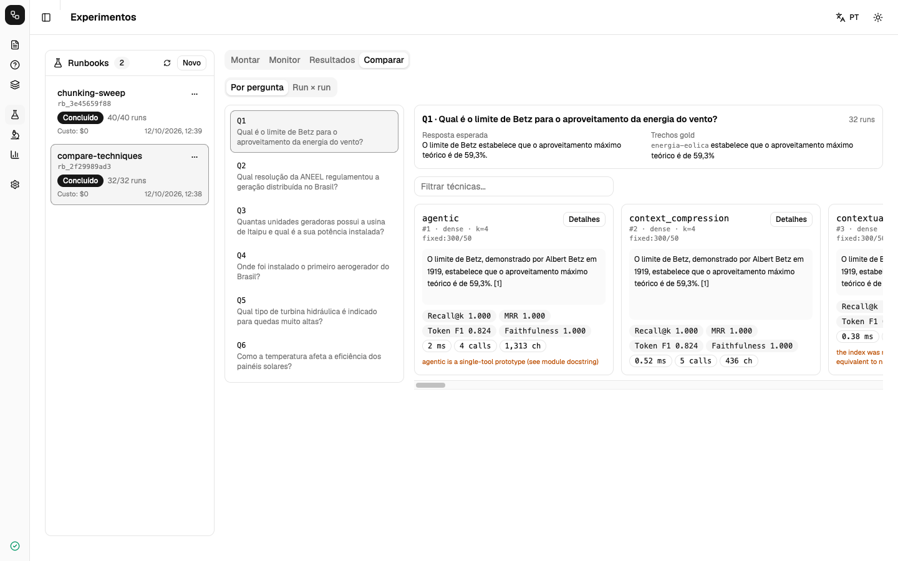

# RagStudio

Ambiente único para **implementar, executar, comparar e validar técnicas RAG** de forma reproduzível. Todas as
técnicas obedecem ao mesmo contrato e passam pelo mesmo fluxo:

```
documento → carga/normalização → chunking → índice → recuperação → (rerank / expansão / compressão) → contexto → geração → resultado → avaliação
```

O produto não é a resposta de uma pergunta, e sim os **dados comparáveis** gerados ao rodar as mesmas perguntas,
sobre o mesmo corpus, com técnicas diferentes: métricas de recuperação e de geração, latência por etapa, tokens,
chamadas ao modelo, custo, contexto enviado e fontes. Esses dados podem ser cruzados com as características dos
documentos (tamanho, estrutura, idioma) para análise empírica.

## Estado

| Item | Situação |
|---|---|
| Técnicas registradas | 28, agrupadas por etapa do pipeline: 24 `implemented`, 4 `prototype` (`self_rag`, `rank_rag`, `recomp`, `speculative_rag`). Lista em `docs/techniques.md` |
| Testes | 343 passam offline com o provider `mock`, 3 pulados (provider real, opcional; o teste de pacote ausente, quando o pacote está instalado; e o de orçamento de contexto para `long_context`, que usa o próprio) |
| Aplicação desktop | Electron + React 19 + shadcn/ui em `Frontend/`, 7 telas; typecheck, lint e build limpos; telas conferidas por screenshot do app rodando |
| Execução com modelo real | **não realizada**. O cliente HTTP foi testado contra um servidor falso compatível com OpenAI |
| Conversão de PDF (Docling 2.64) | funciona: 3 sentenças em PDF importadas pelo app e pela CLI; a pasta completa de 52 não foi rodada por mim |
| Reranker cross-encoder | adaptador exercitado à mão (`sentence-transformers` 5.7.0, modelo padrão em inglês); não avaliado em português |

Os números produzidos com o provider `mock` validam o encanamento, não a qualidade de modelo algum. Detalhes e
pendências em `ROADMAP.md`.

## Instalação e execução

```bash
./run.sh             # 7 verificações (conda, Python, banco, provider, Node, dependências, Electron) e abre o app
./run.sh --demo      # carrega o corpus de exemplo, roda um runbook com o provider simulado e abre o app em modo simulado
./run.sh --dev       # app com hot reload
./run.sh --no-app    # só prepara o ambiente, para usar a CLI
scripts/check.sh     # ruff + testes offline + typecheck, lint e build do Frontend
```

Requisitos: Conda, Python 3.11 e Node.js 20 ou mais novo (testado no 24). `./rs` é o lançador da CLI (equivale a
`python -m ragstudio`); ele procura o ambiente conda `ragstudio`, ou use `RAGSTUDIO_PYTHON`.

## Aplicação desktop

| Tela | O que faz |
|---|---|
| **Corpus** | importa documentos, mostra o perfil de cada um, define splits, constrói índices e testa a recuperação |
| **Perguntas** | conjuntos de perguntas, respostas esperadas e trechos gold; mostra quais métricas o conjunto permite |
| **Técnicas** | catálogo com status, parâmetros e referência |
| **Experimentos** | Montar (três colunas e barra de revisão com a estimativa), Monitor, Resultados e Comparar |
| **Análise** | métricas por eixo de configuração e correlação com as características dos documentos |
| **Relatórios** | relatório HTML, figuras, tabelas e exportações |
| **Referências** | o que significa cada técnica, componente, métrica e conceito, com fontes, guias e bibliografia |
| **Configurações** | provider e modelos, padrões de experimento, aparência, banco |

A interface nunca abre o banco: cada ação chama a CLI Python e recebe JSON, e execuções longas chegam por streaming.
Interface em pt-BR e inglês, tema claro e escuro.




## Uso pela linha de comando (offline, sem custo)

```bash
export RAGSTUDIO_PROVIDER=mock
./rs corpus import --path tests/fixtures/docs --name energia
./rs questions import-json --path tests/fixtures/questions.json --corpus energia
./rs experiments run --file configs/examples/quick_mock.yaml --stream
./rs experiments list                                   # pegue o id do runbook (rb_...)
./rs compare runbook --id <rb_id> --by technique
./rs reports html --runbook-ids <rb_id>                 # Dados/exports/report_*.html
./rs reports export --runbook-ids <rb_id> --table questions --format csv
```

Toda chamada imprime **uma linha JSON final**: `{"ok": true, "data": …}` ou `{"ok": false, "error": …}`. Com
`--stream`, linhas `{"progress": …}` aparecem antes. Logs vão para stderr.

## Usando um modelo de verdade

```bash
./rs config set --section lm_studio --key base_url --value http://localhost:1234   # ou [ollama] base_url
./rs config set --section llm --key model --value <modelo de chat>
./rs config set --section embedding --key model --value <modelo de embedding>
./rs config test-connection
```

Para OpenAI: `./rs config set --section openai --key api_key --value sk-...` e deixe as URLs locais vazias. A chave
fica em `ragstudio/config/config.local.ini`, que está no `.gitignore`. Roteamento: `RAGSTUDIO_PROVIDER` vence; em
`auto`, LM Studio, depois Ollama, depois OpenAI.

## Comandos

| Grupo | Para quê |
|---|---|
| `db` | `migrate`, `status`, `integrity-check`, `backup`, `vacuum` |
| `config` | `show`, `set`, `test-connection`, `list-models` |
| `corpus` | `import`, `list`, `describe`, `profile`, `split`, `delete` |
| `index` | `build`, `list`, `describe`, `search`, `delete` |
| `techniques` | `list`, `describe` |
| `reference` | `list`, `show` |
| `questions` | `import-json`, `create`, `update`, `list`, `export` |
| `experiments` | `preview`, `create`, `run`, `list`, `status`, `show`, `reproduce`, `verify`, `delete-preview`, `delete`, `presets` |
| `evaluate` | `availability`, `rerun`, `metrics`, `review-add`, `agreement` |
| `compare` | `runs`, `runbook`, `characteristics` |
| `reports` | `html`, `figures`, `tables`, `export`, `schema`, `list` |

`./rs <grupo> <comando> --help` mostra as opções.

## Estrutura

```
ragstudio/
  core/         modelos de dados, contrato de técnica, registry, blocos de pipeline, hashing, seeds, timing
  providers/    mock · OpenAI · LM Studio · Ollama (HTTP puro), roteamento, custo, cache de embeddings, fingerprint
  ingest/       loaders (md, txt, json, jsonl, pdf), limpeza, perfil de corpus, splits, arquivos de perguntas
  processing/   chunking: fixed, recursive, sentence, semantic, markdown_headers, parent_child
  stores/       índice em memória (numpy + BM25), DuckDB, FAISS e Chroma (opcionais), grafo de conhecimento
  retrieval/    dense, bm25, hybrid, rrf, mmr
  rerankers/    lexical, llm, cross_encoder (opcional)
  prompts/      templates versionados (pt, en)
  techniques/   UMA técnica por módulo (ou subpacote com technique.py)
  experiments/  runbook (grade), runner, deps instrumentadas, index builder, artefatos, snapshot de ambiente
  evaluation/   métricas de recuperação e de geração, juiz LLM opcional, disponibilidade, agregação
  analysis/     comparação, estatística pareada, características dos documentos, exportações
  reference/    catálogo de verbetes (pt, en) e bibliografia da tela Referências
  reports/      figuras (PNG/SVG/PDF), tabelas (Markdown/LaTeX/CSV), relatório HTML
  db/           SQLite: migrações, repositório (toda a SQL), backup
  cli_groups/   um arquivo por grupo de comandos
configs/examples/   runbooks e configuração de provider de exemplo
Frontend/           aplicação desktop (Electron + Vite + React + TypeScript + Tailwind + shadcn/ui)
tests/              suíte offline + corpus de exemplo
docs/               guias; docs/legacy/ragkit = código de origem dos algoritmos
```

## Documentação

- `docs/running-experiments.md`: corpus, índices, perguntas, runbooks, execução, reprodução
- `docs/comparing.md`: métricas, comparação, estatística, características, relatórios
- `docs/adding-a-technique.md`: como adicionar uma técnica sem tocar no núcleo
- `docs/techniques.md`: catálogo com status, parâmetros e referências
- `docs/data-schema.md`: banco, artefatos e colunas exportadas
- `ROADMAP.md`: o que está feito e o que falta

## Limitações conhecidas

- Nenhuma técnica foi executada contra um LLM real nesta base de código. Rode `tests/test_integration_real.py` antes de confiar em qualquer número.
- `raptor`, `graph_rag` e `agentic` são protótipos com escopo reduzido, descrito no docstring de cada módulo.
- `corrective` não tem o ramo de busca na web do CRAG nem os tokens de reflexão do Self-RAG.
- Métricas de geração são heurísticas lexicais. Para afirmar qualidade de resposta, use o juiz LLM ou revisão humana.
- O índice em memória carrega todos os vetores em RAM. Para corpora grandes use `store: duckdb` ou escreva outro adaptador. Os stores `faiss` e `chroma` trocam só o motor da busca densa: a cópia em numpy continua carregada para BM25 e consultas por id.
- A aplicação desktop foi conferida só com o provider simulado. Seletor de arquivo, cancelamento de um run longo e empacotamento (`electron-builder`) não foram exercitados.
- O Frontend não tem testes automatizados além de typecheck, lint e build.
